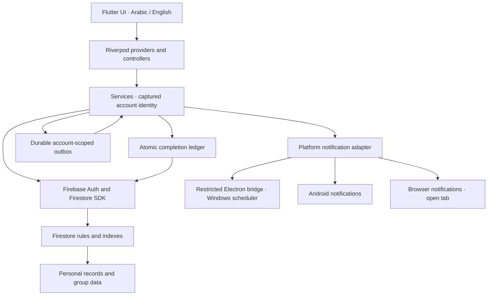

<div align="center">
  
  <h1>Focusly</h1>
  <p>A bilingual workspace for tasks, habits, focus, learning and personal planning.</p>
  <p>
    <a href="https://focusly-87187.web.app">Open the app</a> ·
    <a href="docs/README_AR.md">الدليل بالعربية</a> ·
    <a href="#quick-start">Quick start</a> ·
    <a href="#release-status">Release status</a>
  </p>
</div>

**Current version: 1.1.0+2.** Focusly combines a Flutter interface, Riverpod state management, Firebase Authentication and Cloud Firestore. Its Windows distribution packages Flutter Web inside Electron; Android uses a dedicated release signing key.

The October 3, 2026 update implements the logic review and free feature proposals across account isolation, completion rewards, collaboration, dated history, reminders and productivity tools. The project remains on Firebase Spark with billing disabled. Free quotas apply.

## Contents

- [What you can do](#what-you-can-do)
- [Recent development](#recent-development)
- [Platforms and release status](#release-status)
- [Architecture and data flow](#architecture-and-data-flow)
- [Quick start](#quick-start)
- [Build and package](#build-and-package)
- [Verification](#verification)
- [Firebase configuration and deployment](#firebase-configuration-and-deployment)
- [Repository structure](#repository-structure)
- [Limits and maintenance](#limits-and-maintenance)
- [Technical reports](#technical-reports)

## What you can do

| Area | Available features |
|---|---|
| **Tasks and daily planning** | Tasks and subtasks, priorities, deadlines, simple or counted completion, category/project filters, Eisenhower matrix, up to three My day priorities and an estimated time budget. |
| **Recurring work and templates** | Daily, weekly, monthly, interval and after-completion recurrence; selected weekdays, end dates, skip handling and month-end handling; reusable task, habit and project templates with a preview before applying them. |
| **Organization** | GTD Inbox, clarification, Waiting, Someday and Reference; PARA projects, areas, resources and archives; goals, linked milestones, dependencies, blocked tasks and a recoverable trash area. |
| **Habits** | Custom scheduled days, dated completion logs, a calendar view and streaks calculated from the expected days rather than a mutable counter. |
| **Calendar and focus** | Agenda, week and month views; recurring events; time blocking; Pomodoro with pause/resume, actual focused time and saved sessions; manual time auditing kept separate from Pomodoro time. |
| **Learning and knowledge** | Books and reading logs, courses, learning paths, knowledge notes, SM-2 flashcards, skills with dated progress and study sessions linked to a source, a goal and today's work. |
| **Groups and collaboration** | Private invitations, join approval, owner/admin/moderator/member roles, ownership transfer, an administration audit log, shared assignments, counters, decisions and delay reasons, challenges and dated weekly scores. |
| **Progress and reviews** | XP, levels and achievements; stable completion identities to prevent duplicate rewards; weekly reviews, daily rituals, annual reviews, life analytics, life score and date-range PDF reports. |
| **Health and wellbeing** | Energy and mood check-ins, water/sleep tracking, nutrition logs, workouts, weight/body measurements, blood pressure/pulse records, mental wellbeing entries and social battery tracking. |
| **Personal planning** | Contacts and interaction history, optional keep-in-touch reminders, relationship health, budget transactions and categories, decision journal, bucket list, life areas, legacy journal and project retrospectives. |
| **Workspace experience** | Arabic/English, RTL layouts, themes, text sizing, optional modules, favorites, quick capture, paginated search, saved searches and keyboard shortcuts. |
| **Data and reminders** | JSON backup/import with a preview, CSV exports, local attachment links, account-scoped retry outbox, quiet hours, reminder snooze, notification history and resumable account/group cleanup. |

### Everyday shortcuts

| Shortcut | Action |
|---|---|
| `Ctrl+D` | Open My day. |
| `Ctrl+K` | Open search. |
| `Ctrl+N` | Capture a new idea quickly. |

Productivity tools are available from the navigation menu. Workspace settings control visible modules, favorites and text size. A locally attached file stays on the device; it is not uploaded to a storage service.

## Recent development

The following changes are implemented in the current release. The [implementation report](docs/IMPLEMENTATION_REPORT_2026-10-03.md) maps all 48 review findings and six additional notes to their changes, and the [free features guide](docs/FREE_FEATURES_GUIDE_2026-10-03.md) maps seven foundations and 24 feature proposals.

- **Account lifecycle:** profile provisioning and terms consent gate access to the workspace. Account changes clear account-specific state; asynchronous work captures its original UID. Remember me controls session persistence, passwords retain their original spaces and provider linking preserves the same account identity.
- **Consistent completion:** an immutable completion event, its XP entry and the total are saved together. Retrying the same achievement cannot award it again. Weekly progress uses dated records instead of resetting a shared counter.
- **Safer collaboration:** invitation reads, roles, approvals and membership limits are checked by Firestore rules. Assignment definitions stay fixed after distribution; personal and shared progress use coordinated transactions. Administrative actions have an audit trail.
- **Reliable editing:** transactions read current progress before changing metadata. Inbox conversion, habit logs, reading progress, nutrition day changes, contact history, goal derivation and ritual/review outputs preserve their own identities and failure states.
- **Recoverable operations:** interrupted account/group deletion has saved checkpoints. Deferred completion effects are isolated by account and appear in a retry outbox. Bulk actions report success and failure instead of hiding partial results.
- **Date-based reports:** habit, task, skill, focus and review statistics use stored dates. Unknown legacy history is labeled rather than invented. PDF generation waits for its sources and uses bundled Arabic fonts.
- **Productivity additions:** My day, paginated search, recurrence, templates, task dependencies, milestones, bulk editing, trash, backups, workspace customization and local planning suggestions are connected to the UI.
- **Desktop distribution:** Electron runs the supported Firebase Web SDK with sandboxing, context isolation and a restricted native bridge. Windows reminders are scheduled with the OS. Tray/startup preferences, a local diagnostic log, version/hash checking and an Arabic/English installer are available.
- **Release preparation:** Android uses a dedicated release key whose public fingerprints are registered with Firebase. Windows installation, upgrade, removal and payload integrity were verified. Hosting and Firestore rules were deployed to the real project.

## Release status

Last recorded release validation: **October 3, 2026**.

| Target | Current distribution | Verification and limits |
|---|---|---|
| **Web** | [Live Firebase Hosting app](https://focusly-87187.web.app) | Published assets and active rules match local hashes. Local browser reminders require an open tab. |
| **Windows 10+ x64** | `dist/Focusly-Setup-1.1.0-x64.exe` | Arabic/English installation, launch, in-place upgrade and removal passed. OS reminder registration survived app exit and was then cancelled. The installer has no commercial publisher signature. |
| **Android** | `dist/Focusly-1.1.0-android-release.apk` | Release build and certificate verification passed. A physical-phone run and human Google sign-in are still outside the recorded validation. |
| **Other platforms** | Flutter scaffolding may exist | Firebase configuration and distribution are not prepared for iOS, macOS or Linux. |

Release artifacts are generated under `dist/` and excluded from source control. The Windows installation defaults to `%LOCALAPPDATA%\Programs\Focusly`, creates a Start Menu shortcut and offers an optional desktop shortcut. Its Microsoft VC runtime prerequisite is signature-checked and may need administrator permission if missing.

Release checking retrieves a small HTTPS version/SHA256 manifest; users install an EXE update manually. SHA256 checks file integrity and does not replace a publisher signature. An Android installation signed with a previous debug certificate cannot be directly upgraded with a different release certificate.

## Architecture and data flow



Personal records live under `users/{uid}`; shared records live under `groups/{groupId}`. All 53 registered personal subcollections participate in account-data lifecycle handling, with additional cleanup for nested data and group references.

Services read fresh records for transactions, validate references and preserve progress when metadata changes. Completion identities are derived from their source; retries reuse the identity. Transactions require connectivity. SDK local caching and the deferred-effects outbox have distinct responsibilities, so the app does not report a failed transaction as a completed save.

Firestore rules enforce ownership, membership, schema limits and consistent reward updates. Task and habit activity is self-reported; these rules cannot prove that someone performed the real-world work. Native desktop operations use a limited IPC interface with Node integration disabled in the renderer.

## Quick start

### Prerequisites

- Flutter/Dart: validated with **Flutter 3.41.2 / Dart 3.11**; the Dart constraint is `^3.11.0`.
- Node.js/npm: validated with **Node 24**; use the committed lockfiles.
- Java 17 and an Android SDK for Android builds; Java is also used by the pinned Firestore emulator CLI.
- Windows PowerShell and Inno Setup 6 for the Windows installer.
- Firebase project access only when working against a project you control or deploying changes.

### Run the Web app

```powershell
git clone https://github.com/bavlybasemhelal-dotcom/Focusly.git
Set-Location Focusly
flutter pub get
Push-Location desktop
npm ci
npm run bundle-sdk
Pop-Location
flutter run -d chrome
```

The SDK bundler generates `web/sdk/firebase.js` and `web/sdk/google.js`. Bundled fallback fonts are tracked under `web/fallback-fonts/`; Flutter's bootstrap points there.

The checked-in client configuration points to `focusly-87187`. For an independent fork, configure your own Firebase project before creating accounts or deploying rules. Client Firebase identifiers are not server credentials; access is controlled by Authentication and Firestore rules.

For Android development, use `flutter run -d <device-id>` with a configured Android device/emulator. `flutter run -d windows` uses the native Flutter runner and is not the supported Firebase-connected Windows distribution.

## Build and package

### Web

Bundle the SDK as above, then run:

```powershell
flutter build web --release --no-web-resources-cdn --no-wasm-dry-run
```

Output: `build/web/`. Fonts and the Firebase SDK are served locally with the app; Firebase services still require network access.

### Windows

```powershell
.\windows\installer\build-installer.ps1
```

The installer script builds the Electron payload, checks required files, verifies the Microsoft VC runtime signature and creates the installer plus its SHA256 manifest under `dist/`.

The desktop build scripts currently contain the originating workstation's Flutter/Python paths, and the font helper refers to its Flutter engine directory. Update those tool paths on another machine before building. Node/npm and Inno Setup must also be available. To package an already-built desktop payload:

```powershell
.\windows\installer\build-installer.ps1 -SkipFlutterBuild
```

### Android

Release builds require a private keystore and `android/key.properties`; the Gradle configuration rejects release builds without that file. It does not fall back to a debug signing key.

The configuration contains `storeFile`, `storePassword`, `keyAlias` and `keyPassword`. Keep the existing release key for future compatible updates, store a private backup and register its public SHA1/SHA256 with the Firebase Android app. Both the key and its properties are ignored by Git.

```powershell
flutter build apk --release
```

Output: `build/app/outputs/flutter-apk/app-release.apk`. The recorded 1.1.0 APK was copied to `dist/Focusly-1.1.0-android-release.apk` with a hash/certificate manifest.

## Verification

```powershell
flutter analyze
flutter test --concurrency=2
```

Firestore rule suites run against a local demo project and require Java 17. Port 8080 must be available:

```powershell
Push-Location test/firestore
npm ci
npm test
Pop-Location
```

`npm test` starts the emulator, runs the ownership, reward and group suites, and stops it afterwards. If an appropriate local emulator is already running, `npm run test:rules` runs those same suites directly. These commands do not use production accounts.

```powershell
Push-Location desktop
npm ci
npm test
Pop-Location
```

For a freshly built installer, the isolated smoke test checks install, upgrade, app startup, file hashes, local profile preservation, OS scheduling and uninstall. It refuses to modify an existing registered Focusly installation:

```powershell
.\windows\installer\test-installer.ps1 -InstallerPath .\dist\Focusly-Setup-1.1.0-x64.exe
```

The workstation-specific Electron/Playwright harness used for release validation lives in ignored local tooling and is not included in a source clone. Adapt or provide that harness before running this smoke test elsewhere; the Dart, rule and desktop boundary suites are committed.

| Recorded check | Result |
|---|---|
| Dart static analysis | No issues. |
| Flutter logic/widget/regression tests | **505 passed**. |
| Firestore ownership/reward/group rule tests | **39 passed**. |
| Electron runtime boundary tests | **2 passed**. |
| Installed Windows payload | **149 file hashes matched**; install, upgrade and uninstall passed. |
| Authenticated packaged-app integration | Terms stored; repeated completion kept total XP at 10; direct forged balance update rejected; English/Arabic UI and My day tested. |
| Android signing | Dedicated RSA3072 release certificate verified and registered with Firebase. |
| Live Firebase release | Rules and published assets matched; one composite index and 12 field-index overrides were READY; billing disabled. |

These are recorded results, not a claim of complete code coverage or continuous GitHub CI. Read the [public verification snapshot](docs/verification/2026-10-03.json) and [test/deployment report](docs/IMPLEMENTATION_REPORT_2026-10-03.md) for scope and limits.

## Firebase configuration and deployment

Configuration locations:

| File | Purpose |
|---|---|
| `lib/firebase_options.dart` | Flutter platform configuration. |
| `android/app/google-services.json` | Android Firebase client configuration. |
| `desktop/firebase-config.json` | Desktop Web SDK and external-browser auth configuration. |
| `firestore.rules` | Ownership, collaboration and completion validation. |
| `firestore.indexes.json` | Composite and collection-group indexes. |
| `firebase.json` | Hosting, rules, index and emulator configuration. |

For another project, update all relevant client configurations, enable the Email/Password and Google providers you intend to use, authorize the development/hosting domains and register the Android signing fingerprints. Do not commit service-account keys, auth tokens or private signing keys.

After building `build/web`, authorized maintainers can deploy with the pinned local CLI:

```powershell
node test/firestore/node_modules/firebase-tools/lib/bin/firebase.js login
node test/firestore/node_modules/firebase-tools/lib/bin/firebase.js deploy --only "firestore,hosting" --project focusly-87187
```

Replace the project ID for a fork. Deployment changes the selected Firebase project; a Git push alone does not redeploy it.

The October 3 production update preserved existing balances. One legacy completed task received a zero-XP reserved completion identity without an invented history date. The disposable QA account and its records were deleted, and original documents were compared unchanged. Private backups and credentials remain outside the repository.

## Repository structure

```text
assets/                 App images, Cairo fonts and native notification helper
lib/
  core/                 Auth, data contracts, account lifecycle and platform adapters
  features/             Feature models, services, providers, pages and widgets
  screens/              App shell, onboarding and authentication screens
desktop/                Electron host, restricted IPC, SDK bundler and boundary tests
windows/installer/      Inno Setup configuration and build/smoke-test scripts
android/                Android build and Firebase configuration
web/                    Bootstrap, tracked fallback fonts and release metadata
test/                   Flutter regression/widget tests
  firestore/            Ownership, reward and group rule suites
docs/                   Reviews, implementation reports and public verification
```

Build outputs, `node_modules`, Firebase caches, private backups, signing keys and detailed local test logs are ignored.

## Limits and maintenance

- **Free usage:** no paid AI, Cloud Functions or Cloud Storage was introduced. Firebase Spark still has storage, read/write and hosting-transfer quotas. See [Firebase pricing](https://firebase.google.com/pricing) and [Hosting usage limits](https://firebase.google.com/docs/hosting/usage-quotas-pricing).
- **Notifications:** scheduled means registered, not delivered. Windows settings and quiet hours affect display. Browser local reminders require an open tab; this release adds no closed-browser push service.
- **Connectivity:** transactions need a connection. The outbox tracks deferred operations and retries; it does not make every workflow available offline.
- **History and scale:** missing legacy dates remain unknown. History/search/export/cleanup use pages or batches; some direct live lists still grow their read cost with account size.
- **Device validation:** a human Google authorization flow and physical Android device delivery were not part of the recorded release validation.
- **Personal trackers:** health and wellbeing records are personal tracking tools, not medical diagnoses. Local attachments reference a device path and are not portable cloud uploads.

When extending a feature, keep account IDs stable across asynchronous work, reuse completion identities, add new personal subcollections to `user_data_collections.dart`, update rules/indexes and add meaningful failure/concurrency regression tests. Preserve the existing Android release key and document platform limits alongside the feature.

## Technical reports

| Document | Purpose |
|---|---|
| [Implementation report](docs/IMPLEMENTATION_REPORT_2026-10-03.md) | Changes for the 48 review findings and six additional notes, verification, deployment and limits. |
| [Free features guide](docs/FREE_FEATURES_GUIDE_2026-10-03.md) | Seven foundations, 24 proposals and how to use the delivered additions. |
| [Implementation checklist](docs/IMPLEMENTATION_STATUS_2026-10-03.md) | Completed scope with explicit platform and scale boundaries. |
| [Verification snapshot](docs/verification/2026-10-03.json) | Sanitized recorded results, hashes and release checks. |
| [Original logic review](docs/LOGIC_REVIEW_2026-10-02.md) | Historical findings before the 1.1.0 implementation. |
| [Original proposals](docs/IMPROVEMENT_PROPOSALS_2026-10-02.md) | The original free improvement plan. |
| [Initial audit](docs/AUDIT_2026-10-02.md) | Earlier baseline analysis and first fixes. |

Bundled fonts retain their redistribution licenses in [assets/fonts](assets/fonts) and [web/fallback-fonts](web/fallback-fonts). The Electron package is private and marked `UNLICENSED`; this repository does not currently include a separate application license.
